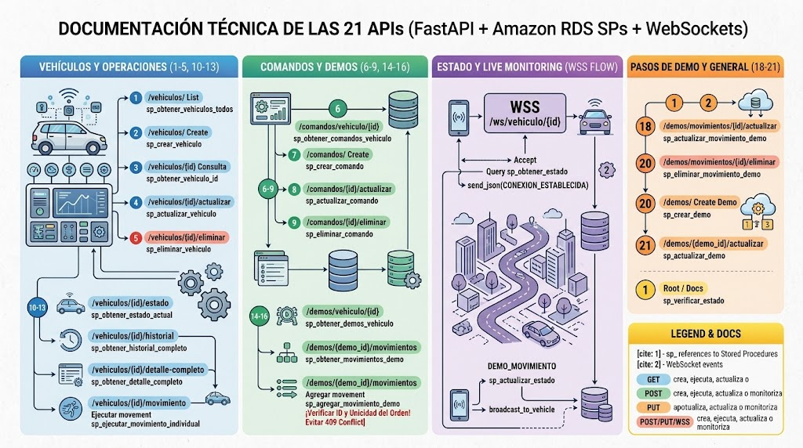

# 🚗 API Vehículo IoT 1.0.0 (OAS 3.1)

API RESTful y canal WebSocket desarrollados con **FastAPI**, **Python (Programación Orientada a Objetos)**, **Amazon RDS (MySQL con 21 Stored Procedures)** y **WebSockets** para la gestión, control y monitoreo en tiempo real de vehículos IoT.

---

## 📌 Servidor y Endpoints Base

Para interactuar con la API desplegada en la nube de **Amazon Web Services (AWS)** y realizar pruebas de todos los métodos y eventos en tiempo real, se deben utilizar los métodos principales asegurados con **SSL/TLS**:

* **Documentación Interactiva y Métodos HTTP (Swagger UI):**  
  👉 **`https://44.196.75.158/docs`**
* **Canal WebSocket en Vivo (WSS / Monitoreo en Tiempo Real):**  
  👉 **`wss://44.196.75.158/ws/vehiculo/5`**
* **Servidor en la Nube (AWS EC2 / IP Pública):**  
  `https://44.196.75.158` (o `http://44.196.75.158`)
* **Base de Datos en la Nube (Amazon RDS MySQL 8.0):**  
  Conexión privada mediante Stored Procedures. Todas las credenciales sensibles permanecen ocultas en el archivo `.env`.

---

## 🗺️ Arquitectura General y Funcionamiento de las 21 APIs

A continuación se presenta el diagrama de arquitectura y flujo técnico que modela la interacción del sistema, donde **FastAPI** actúa como orquestador, ejecutando los **21 Stored Procedures** en **Amazon RDS** para persistencia transaccional y transmitiendo eventos asíncronos en tiempo real vía **WebSockets**:



```
┌──────────────────────────────────────────────────────────────────────────────────────────────────┐
│                   DOCUMENTACIÓN TÉCNICA DE LAS 21 APIs (FastAPI + RDS + WebSockets)              │
├─────────────────────┬─────────────────────┬──────────────────────────┬───────────────────────────┤
│ 1. VEHÍCULOS Y      │ 2. COMANDOS Y DEMOS │ 3. ESTADO Y MONITOR      │ 4. PASOS DE DEMO Y        │
│    OPERACIONES      │    (6-9, 14-16)     │    EN VIVO (WSS FLOW)    │    GENERAL (18-21, Root)  │
│    (1-5, 10-13)     │                     │                          │                           │
├─────────────────────┼─────────────────────┼──────────────────────────┼───────────────────────────┤
│ • CRUD de Vehículos │ • Catálogo comandos │ • Handshake WSS          │ • Actualizar/Borrar pasos │
│ • Estado actual     │ • CRUD de DEMOs     │ • Consulta SP estado ini │ • Crear/Actualizar DEMO   │
│ • Historial (top 10)│ • Agregar paso DEMO │ • Broadcast en vivo      │ • Health Check / Root     │
│ • Mov. Individual   │ • Regla orden único │ • Eventos a App y Carro  │ • Documentación Swagger   │
└─────────────────────┴─────────────────────┴──────────────────────────┴───────────────────────────┘
```

### Desglose por Módulos y Stored Procedures:

#### 1. Vehículos y Operaciones (`/vehiculos`):
* `GET /vehiculos/` — Listar todos los vehículos (`sp_obtener_vehiculos`).
* `POST /vehiculos/` — Crear un vehículo (`sp_crear_vehiculo`).
* `GET /vehiculos/{vehiculo_id}` — Consultar detalle de vehículo por ID (`sp_obtener_vehiculo`).
* `GET /vehiculos/{vehiculo_id}/estado` — Consultar el último estado del vehículo (`sp_obtener_estado`).
* `GET /vehiculos/{vehiculo_id}/historial` — Consultar los últimos 10 movimientos (`sp_obtener_historial`).
* `GET /vehiculos/{vehiculo_id}/detalle-completo` — Obtener vehículo, estado, comandos y DEMOs en una sola consulta.
* `POST /vehiculos/{vehiculo_id}/actualizar` — Actualizar vehículo (`sp_actualizar_vehiculo`).
* `POST /vehiculos/{vehiculo_id}/eliminar` — Eliminar vehículo (`sp_eliminar_vehiculo`).
* `POST /vehiculos/{vehiculo_id}/movimiento` — Ejecutar movimiento individual atómico (`sp_actualizar_estado` + `sp_registrar_historial`).
* `POST /vehiculos/{vehiculo_id}/demo/iniciar` — Iniciar ejecución asíncrona de DEMO en segundo plano.
* `POST /vehiculos/{vehiculo_id}/demo/detener` — Cancelar DEMO activa de manera inmediata.

#### 2. Comandos (`/comandos`):
* `GET /comandos/vehiculo/{vehiculo_id}` — Listar comandos de un vehículo (`sp_obtener_comandos_vehiculo`).
* `POST /comandos/` — Crear comando (`sp_crear_comando`).
* `POST /comandos/{comando_id}/actualizar` — Actualizar comando (`sp_actualizar_comando`).
* `POST /comandos/{comando_id}/eliminar` — Eliminar comando (`sp_eliminar_comando`).

#### 3. Demostraciones y Pasos (`/demos`):
* `GET /demos/vehiculo/{vehiculo_id}` — Listar DEMOs de un vehículo (`sp_obtener_demos`).
* `GET /demos/{demo_id}/movimientos` — Listar movimientos de una DEMO (`sp_obtener_movimientos_demo`).
* `POST /demos/` — Crear DEMO (`sp_crear_demo`).
* `POST /demos/{demo_id}/actualizar` — Actualizar DEMO (`sp_actualizar_demo`).
* `POST /demos/{demo_id}/eliminar` — Eliminar DEMO (`sp_eliminar_demo`).
* `POST /demos/{demo_id}/movimientos` — Agregar movimiento a una DEMO (`sp_agregar_movimiento_demo`). *Valida orden único para evitar HTTP 409 Conflict*.
* `POST /demos/movimientos/{movimiento_id}/actualizar` — Actualizar movimiento de DEMO (`sp_actualizar_movimiento_demo`).
* `POST /demos/movimientos/{movimiento_id}/eliminar` — Eliminar movimiento de DEMO (`sp_eliminar_movimiento_demo`).

#### 4. General:
* `GET /` — Root / Verificación de estado operativo del servicio.

---

## ⚡ Conexión y Eventos WebSocket (Monitoreo en Tiempo Real)

El canal WebSocket permite la comunicación bidireccional en tiempo real entre el servidor, los dashboards de monitoreo, la aplicación móvil y el hardware IoT (ESP32).

### Método Principal de Conexión:

Para conectarse y monitorear el vehículo `5` en la nube de AWS bajo conexión segura cifrada con SSL/TLS, se utiliza el método:

👉 **`wss://44.196.75.158/ws/vehiculo/5`**

*(En entorno de pruebas local se puede emplear `ws://localhost:8000/ws/vehiculo/5`).*

### Validación de Conexión:
Antes de aceptar la conexión, el servidor verifica la existencia del vehículo en **Amazon RDS**:
1. Si el vehículo **no existe**, rechaza la conexión con el código de cierre **`1008` (Policy Violation)**.
2. Si ocurre un error de base de datos interno, rechaza con el código **`1011` (Internal Server Error)**.
3. Si el vehículo es válido, acepta el WebSocket y consulta inmediatamente `sp_obtener_estado` para enviar el evento `conexion_establecida` con el estado más reciente.

### Tipos de Eventos Emitidos por el Servidor:

* **`conexion_establecida`:** Enviado al conectar, contiene el estado inicial más reciente devuelto por Amazon RDS.
* **`movimiento_individual`:** Emitido cuando se ejecuta un movimiento manual vía `POST /vehiculos/{id}/movimiento`.
* **`demo_inicio`:** Notifica el comienzo de la rutina de prueba autónoma en segundo plano.
* **`demo_movimiento`:** Emitido en cada paso de la DEMO (N movimientos secuenciales con orden, duración y pausa en ms).
* **`demo_fin`:** Notifica la conclusión exitosa de todos los movimientos de la DEMO.
* **`demo_cancelada`:** Emitido cuando la DEMO es interrumpida inmediatamente por el usuario mediante `POST /vehiculos/{id}/demo/detener`.
* **`eco_cliente_ws`:** Respuesta de confirmación en formato JSON a mensajes enviados desde el cliente (ej. pruebas interactivas de Thunder Client).
* **`demo_error`:** Notifica si ocurre una excepción inesperada durante la ejecución de la rutina.

---

## 📊 Reglas de Negocio: Historial vs. DEMO

| Tipo de Operación | ¿Afecta el Estado Actual? | ¿Genera Historial Permanente? | Razón Técnica |
|---|:---:|:---:|---|
| **Movimiento Individual (POST)** | **SÍ** | **SÍ** | Ejecuta `sp_actualizar_estado` + `sp_registrar_historial` en una sola transacción atómica en RDS (`BaseRepository._escribir`). Guarda la auditoría de cada orden manual. |
| **Ejecución de DEMO (POST)** | **SÍ** | **NO** | Solo actualiza el estado en tiempo real (`sp_actualizar_estado`) y emite eventos WebSocket. Preserva la tabla de historial libre de ráfagas masivas de prueba repetitivas. |

> **Nota sobre el Historial:** El endpoint `GET /vehiculos/{id}/historial` devuelve exclusivamente los **10 movimientos individuales más recientes** ordenados de más nuevo a más antiguo (`ORDER BY ... DESC`).

---

## 🎯 Parámetros y Datos de Prueba del Entorno

En la base de datos `vehiculo_iot` de Amazon RDS se encuentran configurados los siguientes datos listos para pruebas:

* **ID de Vehículo Principal:** `5` (Excavadora 01)
* **ID de DEMO Principal:** `2` (Secuencia de 8 movimientos)
* **Rango de Comandos Disponibles:** IDs `14` al `22`

| ID (`comando_id`) | Nombre de la Acción | Código de Hardware (`codigo`) | Función en el Vehículo |
|:---:|:---:|:---:|---|
| **14** | `AVANZAR` | `1` | Desplaza el vehículo hacia adelante |
| **15** | `RETROCEDER` | `2` | Desplaza el vehículo hacia atrás |
| **16** | `GIRAR_IZQUIERDA` | `3` | Rota sobre las orugas hacia la izquierda |
| **17** | `GIRAR_DERECHA` | `4` | Rota sobre las orugas hacia la derecha |
| **18** | `SUBIR_BRAZO` | `5` | Eleva el servo del brazo mecánico |
| **19** | `BAJAR_BRAZO` | `6` | Desciende el servo del brazo mecánico |
| **20** | `ABRIR_PALA` | `7` | Abre la pinza/pala del mecanismo |
| **21** | `CERRAR_PALA` | `8` | Cierra la pinza/pala para sujeción |
| **22** | `DETENER` | `9` | Frena todos los actuadores a neutro |

---

## 🚀 Despliegue en AWS EC2 (Producción con SSL) y Entorno Local

### 1. Despliegue en AWS EC2 (Servidor en la Nube con SSL / Puerto 443)

En la instancia Windows Server de AWS EC2 (`44.196.75.158`):

```powershell
PS C:\Users\Administrator\Desktop\api_vehiculo_iot> .\.venv\Scripts\Activate.ps1
(.venv) PS C:\Users\Administrator\Desktop\api_vehiculo_iot> uvicorn main:app --host 0.0.0.0 --port 443 --ssl-keyfile="C:\Users\Administrator\Desktop\api_vehiculo_iot\cert\key.pem" --ssl-certfile="C:\Users\Administrator\Desktop\api_vehiculo_iot\cert\cert.pem" --reload
```

> **Certificados SSL:** Con los certificados cargados en `--ssl-keyfile` y `--ssl-certfile`, la API escucha sobre **HTTPS** y **WSS** directamente en el puerto seguro `443`.

### 2. Despliegue en Entorno Local de Desarrollo (Localhost / Puerto 8000)

1. **Crear y activar el entorno virtual:**
   ```powershell
   python -m venv .venv
   .venv\Scripts\activate
   ```

2. **Instalar dependencias:**
   ```powershell
   pip install -r requirements.txt
   ```

3. **Configurar variables de entorno (`.env`):**
   Copia la plantilla `.env.example` y define tus credenciales reales:
   ```env
   DB_HOST=tu_instancia_rds.amazonaws.com
   DB_PORT=3306
   DB_NAME=vehiculo_iot
   DB_USER=tu_usuario_rds
   DB_PASSWORD="tu_password_seguro"
   CORS_ORIGINS=*
   ```

4. **Verificar conexión con Amazon RDS:**
   ```powershell
   python probar_conexion.py
   ```
   *Debe responder:* `Conexión exitosa con RDS`

5. **Iniciar el servidor local:**
   ```powershell
   uvicorn main:app --reload --port 8000
   ```

---

## 🧪 Pruebas con Thunder Client / cURL / Swagger

Para interactuar con el entorno en la nube, el método principal es a través de la interfaz segura Swagger UI:  
👉 **`https://44.196.75.158/docs`**

### 1. Consultas GET

```http
### Listar vehículos
GET https://44.196.75.158/vehiculos/

### Consultar estado del vehículo 5
GET https://44.196.75.158/vehiculos/5/estado

### Consultar historial (top 10 movimientos)
GET https://44.196.75.158/vehiculos/5/historial

### Detalle completo del vehículo 5
GET https://44.196.75.158/vehiculos/5/detalle-completo

### Listar comandos habilitados del vehículo 5
GET https://44.196.75.158/comandos/vehiculo/5

### Listar movimientos de la DEMO 2
GET https://44.196.75.158/demos/2/movimientos
```

### 2. Operaciones POST

#### Movimiento Individual (Avanzar)
```http
POST https://44.196.75.158/vehiculos/5/movimiento
Content-Type: application/json

{
  "comando_id": 14,
  "origen": "THUNDER_CLIENT"
}
```

#### Iniciar DEMO 2
```http
POST https://44.196.75.158/vehiculos/5/demo/iniciar
Content-Type: application/json

{
  "demo_id": 2
}
```

#### Detener DEMO Activa
```http
POST https://44.196.75.158/vehiculos/5/demo/detener
```

---

## 🛡️ Gestión de Errores y Códigos HTTP

| Código | Significado | Causa Habitual |
|:---:|---|---|
| **200 / 201** | Operación Exitosa | Solicitud procesada correctamente o recurso creado. |
| **400** | Bad Request | Datos inválidos, comando no autorizado o excepción `SIGNAL SQLSTATE '45000'` lanzada por un Stored Procedure de MySQL. |
| **404** | Not Found | Vehículo, comando o DEMO inexistente en Amazon RDS. |
| **409** | Conflict | Ya existe una DEMO en ejecución para ese vehículo, o conflicto de clave única (ej. orden repetido en un paso de DEMO). |
| **422** | Unprocessable Entity | Error en la estructura JSON del cuerpo de la petición (validado por Pydantic). |
| **500** | Internal Server Error | Error no controlado o interrupción en la conexión hacia Amazon RDS. |

---

## 📂 Estructura del Proyecto

```text
api_vehiculo_iot/
│
├── config/
│   ├── __init__.py
│   └── database.py                 # Conexión a Amazon RDS MySQL con PyMySQL
│
├── repositories/                   # Ejecución de los 21 Stored Procedures
│   ├── __init__.py
│   ├── base_repository.py          # Clase base con contexto transaccional
│   ├── vehiculo_repository.py      # Stored procedures de vehículos
│   ├── comando_repository.py       # Stored procedures de comandos
│   ├── demo_repository.py          # Stored procedures de DEMOs y sus pasos
│   └── estado_historial_repository.py # Stored procedures de estado e historial
│
├── services/                       # Lógica de negocio y concurrencia
│   ├── __init__.py
│   └── operacion_service.py        # Orquestación de movimientos y DEMOs asíncronas
│
├── routers/                        # Endpoints REST y WebSocket
│   ├── __init__.py
│   ├── vehiculo_router.py          # Rutas /vehiculos
│   ├── comando_router.py           # Rutas /comandos
│   ├── demo_router.py              # Rutas /demos
│   └── ws_router.py                # Ruta /ws/vehiculo/{id} y validación 1008
│
├── schemas/                        # Validación de entradas con Pydantic
│   ├── __init__.py
│   ├── gestion_schema.py           # Modelos de datos para CRUD
│   └── movimiento_schema.py        # Modelos de datos para movimiento y DEMO
│
├── ws_manager/                     # Gestión de WebSockets
│   ├── __init__.py
│   ├── eventos.py                  # Definición de tipos de eventos estándar
│   └── manager.py                  # ConnectionManager (pools de clientes por vehículo)
│
├── .env                            # Variables de entorno privadas (ignorado en Git)
├── .gitignore                      # Exclusiones de Git (.env, .venv, etc.)
├── main.py                         # Entrada FastAPI, middlewares CORS y handlers de error
├── probar_conexion.py              # Script de prueba de conectividad con Amazon RDS
└── requirements.txt                # Dependencias del proyecto
```
